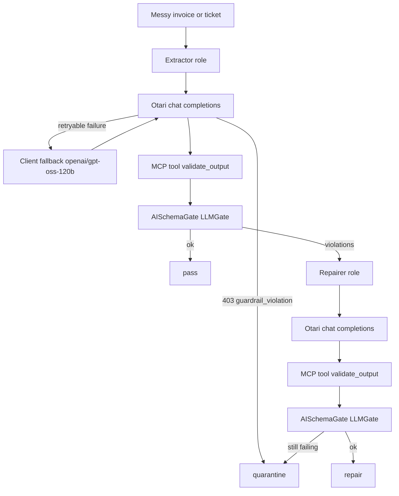

# Developers Wilding

Messy invoices and support notes go in. A JSON object that matches a contract comes out, or the note is quarantined.

An extractor model on the hosted [Otari](https://otari.ai) gateway turns the note into JSON. [AISchemaGate](https://www.aischemagate.dev/docs/llm-sdk-reference) (`LLMGate` from `aischemagate`) checks types, enums, and ranges. When the check fails, a repairer model from a different vendor rewrites the JSON and the check runs again. Each note is reported as **pass**, **repair**, or **quarantine**.

Live calls use the workspace key in `OTARI_API_KEY`. That value is read at runtime and is never written by this repo. `--dry-run` replays authored fixtures and does not call Otari, so tests run without the key.

A hosted run already confirmed: chat completions, the extractor and repairer roles, a repair (Qwen, then Mistral), that the `guardrails` field is accepted, and that `user` is sent only when set because a mismatched `user` is rejected. Still unverified: the dashboard routing policy, hosted MCP, a guardrail mandate, a live block or flag, and the `Otari-End-User-Budget` header. A second hosted run on 2026-10-30 also confirmed a live fallback (`example/not-a-deployed-model` returned HTTP 400 `invalid_model`, then `openai/gpt-oss-120b` answered) and a live quarantine (sample 04 stayed missing `ticket_id` after the repairer). In that run sample 05 (guardrail mode `block`) got HTTP 502 from both Qwen and gpt-oss and ended as an error, so no block or flag was observed. Live finding (2026-10-30, three probes): with guardrail mode `block`, the gateway answered HTTP 502 with detail "guardrail profile 'prompt-injection' requested but no guardrails service is configured. Set OTARI_GUARDRAILS_URL on the gateway or pass `url` on the guardrail entry." That happened on sample 05 and on a plain hello prompt. With mode `monitor`, sample 05 returned HTTP 200 and header `Otari-Guardrails` `[{"profile":"prompt-injection","mode":"monitor","valid":null,"score":null}]`, which means the check was not evaluated. The client now reports a 5xx whose detail mentions a guardrail, when guardrails are sent, as status `error` with code `guardrail_upstream_error`. It is not retried on the fallback model, and it is never counted as a block, flag, or quarantine. Open upstream question (owner: Alex Suarez): how a hosted workspace enables the guardrails service, or which `url` a guardrail entry should name. Sample 02 passed on the first extraction in that run, so it was not repaired. An unauthenticated probe on 2026-10-30 checked the URL shape only: `GET https://otari.ai/api/v1/models` returned HTTP 401, and `GET https://api.otari.ai/v1/models` returned HTTP 404 telling the client to use `/api/v1`.

## Architecture



Roles:

| Role | Model id | Vendor |
| --- | --- | --- |
| Extractor | `alibaba/qwen3-235b-a22b-instruct-2507` | Alibaba |
| Repairer | `mistralai/mistral-small-3.2-24b-instruct-2506` | Mistral |
| Client-side fallback for either role | `openai/gpt-oss-120b` | OpenAI |

Model ids are the plain `vendor/model` form. Role calls set `max_tokens` (default 256, clamped at 512), `temperature` 0, and `response_format` `json_object`. The fallback model `openai/gpt-oss-120b` is a reasoning model, so that call uses `max_tokens` 2048. 2048 is a bound so the cap is not spent before the JSON; it is not a measured minimum. `user` is omitted unless `--user` or `OTARI_USER` is set.

Validation is `LLMGate.validate_only`, reached through the MCP tool `validate_output`. The gate is constructed with the caller's OpenAI-compatible client (`llm=`). The check runs in-process on the engine installed with `aischemagate`. The hosted AISchemaGate egress API was not called.

## Quickstart

```bash
python -m pip install -e ".[dev]"
python -m demo run samples/ --dry-run
pytest -q
```

Live run, after the dashboard steps below:

```bash
export OTARI_API_KEY="paste-the-workspace-key-here"
python -m demo run samples/
```

Do not pass `--user` unless that string is the API key's own user. A hosted run rejected a mismatched `user`. Do not commit the key. `.env.example` lists the variable names with empty values.

Other entry points:

```bash
python -m demo run samples/ --dry-run --json
python -m demo mcp
```

`python -m demo mcp` speaks newline-delimited JSON-RPC on stdio and exposes `validate_output`.

## Otari features used

Judges should score a feature only where this repo actually exercises it. "Live-verified" means a hosted call already observed it. A dry-run does not add to that list.

| Feature | What the code does | Where | Live-verified |
| --- | --- | --- | --- |
| Distinct model roles | Extractor and repairer are different open-weight ids from different vendors. Each sample names one role, then the other only after a contract violation. | `demo/config.py`, `demo/pipeline.py` (`extractor_models`, `repairer_models`) | Yes. A hosted run repaired with Qwen, then Mistral. |
| Routing / fallback | `OtariClient.complete` walks the role's model list. Retryable statuses include 404, 408, 409, 429, 500, 502, 503, 504, transport errors, and a 400/422 whose body says the model does not exist. A guardrail result and a budget refusal are not retried. Sample `03_invoice_fallback` names `example/not-a-deployed-model` first, then `openai/gpt-oss-120b` at `max_tokens` 2048. | `demo/otari.py`, `samples/03_invoice_fallback/options.json` | Live-verified: the unknown id returned HTTP 400 `invalid_model` and `openai/gpt-oss-120b` answered. Dashboard policy not applied. |
| Budget cap | Inputs are a few lines. Role `max_tokens` defaults to 256 and is clamped to 512. The reasoning fallback uses 2048. A body whose code or detail contains `budget` on HTTP 402, 403, or 429 raises `BudgetExceeded` and the run stops. | `demo/config.py`, `demo/otari.py`, `demo/cli.py` | No |
| Per-user attribution | `user` is omitted unless `--user` or `OTARI_USER` is set. When `OTARI_END_USER_BUDGET` is set, the client also sends header `Otari-End-User-Budget`. | `demo/otari.py` `_payload` | The omit-unless-set behavior and the rejection of a mismatched `user` are live-verified. The budget header is not. |
| Guardrails | Requests send `guardrails: [{profile, mode, on: [input]}]` unless `--guardrail-mode off`. Default profile `prompt-injection`, mode `monitor`. Sample `05_ticket_guardrail` sets mode `block` and sends a prompt-injection note. HTTP 403 `guardrail_violation` is a block. A 200 whose guardrail header or result says flag or block is a flag. Either one quarantines the note and does not call the repairer. | `demo/otari.py`, `samples/05_ticket_guardrail/options.json` | The request field was accepted on a hosted run. A live block or flag was not observed. Monitor mode was not blocked. With mode `block`, the gateway answered HTTP 502 because no guardrails service is configured. That is reported as an upstream guardrail error, not a block. Monitor returned 200 with `valid: null` (not evaluated). |
| MCP | Tool `validate_output` is the validation path the pipeline calls, via the same JSON-RPC handler as `python -m demo mcp`. Stdio is newline-delimited JSON. `Content-Length` is still accepted. `initialize` echoes the client's `protocolVersion` when it is supported, otherwise `2025-06-18`. Hosted Otari needs a Streamable HTTP URL. This stdio server is not that URL. | `demo/mcp_server.py`, `demo/pipeline.py` | No |

## Dashboard setup still required

These clicks are the operator's job. This environment did not perform them. Labels match the hosted how-to pages read from docs.otari.ai on 2026-10-30. Where a page did not name a control, this list does not invent one.

### API key

1. Open the workspace (top-left).
2. Open **API Keys**.
3. Click **Create Key**. Copy the token once. It is shown only then.
4. Export it as `OTARI_API_KEY` in the shell. Do not put it in the repo.

The published quickstart still shows `https://api.otari.ai/v1`. The live host probe above answered that path with HTTP 404 and said to use `/api/v1`. This client posts to `https://otari.ai/api/v1/chat/completions`. Override with `--base-url` or `OTARI_BASE_URL` if your workspace documents a different origin.

Confirm a call, when you make one, on the workspace **Usage** tab. This repo has not seen that tab.

### Routing policy

From [Create a multi-provider routing](https://docs.otari.ai/how-to-guides/create-a-multi-provider-routing):

1. Open the target workspace.
2. Open **Routing**.
3. Click **Policies**.
4. Name the policy `wilding-extractor`.
5. Choose **Add a fallback chain**.
6. First entry: `alibaba/qwen3-235b-a22b-instruct-2507`. Second entry: `openai/gpt-oss-120b`.
7. Click **Create policy**.
8. Create `wilding-repairer` the same way. First entry: `mistralai/mistral-small-3.2-24b-instruct-2506`. Second entry: `openai/gpt-oss-120b`.

The same guide says a routing policy routes across **your** provider keys. Wallet-billed models are served when the request names one model directly. A policy entry with no provider key of yours is skipped, and a request whose entries all fail that way is refused with `managed_credential_unsupported`. This demo therefore names each role model on the request and does client-side fallback. Create the policies if the workspace has provider keys for those models. With only the hosted wallet, do not expect the policy to replace the model id. That interaction was not live-verified.

### Budget cap and per-user budgets

Account cap, from [Set a budget & ceiling](https://docs.otari.ai/how-to-guides/set-a-budget-and-ceiling). A budget does not block requests until a spend ceiling uses it.

1. Open **Organization** and select **Spend & Budgets**.
2. Click **Add budget**.
3. Name: `wilding-cap`. Amount: `2` (USD). Period: **Monthly**.
4. Click **Add budget**.
5. Click **Add ceiling**.
6. Capping: the demo workspace (the wizard offers the whole organization or one workspace).
7. Provider instance: leave blank so the ceiling covers every provider.
8. Budget: `wilding-cap`.
9. Name: `wilding-workspace-ceiling`.
10. Click **Add ceiling**.

The concepts page at `otari.ai/docs/hosted/concepts/budgets` also describes a member scope ("all members, or one specific member"). The ceiling wizard text on docs.otari.ai does not include a member picker. If the dashboard you open shows a member control, add a second ceiling for the member that owns the API key, with an amount no higher than the workspace ceiling. That control was not confirmed.

Per-user attribution on the request:

- A hosted run rejected a `user` that did not match the API key. This client therefore omits `user` unless `--user` or `OTARI_USER` is set to that key's own user. That behavior is live-verified.
- The self-hosted access-control page (`docs.otari.ai/otari/for-operators/access-control.md`) documents service keys: the first request that carries a new `user` creates an end user, and header `Otari-End-User-Budget` selects the budget at creation time. Later requests keep the budget already stored. That page is the operator guide, not the hosted Spend & Budgets wizard. Set `OTARI_END_USER_BUDGET` only after the key is a service key that is allowed to assign that budget. The header's effect on hosted otari.ai is **unverified**.

Exact error code for an exhausted ceiling was not in the pages read. The client treats HTTP 402, 403, or 429 as a budget stop when the code or detail contains `budget`, and it does not try the fallback model.

### Guardrails

From [Manage guardrails](https://docs.otari.ai/how-to-guides/manage-guardrails):

1. Open **Organization → Guardrails**.
2. Click **Configure guardrail**.
3. Pick a risk type the wizard lists (bias, hallucination, content safety, PII, or toxicity) and a catalog guardrail for a prompt-injection style check if the catalog offers one.
4. Name it `wilding-prompt-injection`.
5. API key: enter `None` to use the guardrail's environment variable, or paste the credential the wizard asks for.
6. Click **Configure guardrail**.
7. Click **Mandate a guardrail**.
8. Choose the catalog guardrail you just configured.
9. Check name: `wilding-input-check`.
10. Start in **monitor**. Move to **block** when you want refusals. If the guardrail cannot run, choose refuse only after you switch to block (the page says only blocking mandates can refuse).
11. Select the demo workspace.
12. Click **Mandate a guardrail**.

The client sends:

```json
"guardrails": [{"profile": "prompt-injection", "mode": "monitor", "on": ["input"]}]
```

A hosted run accepted this field. Sample `05_ticket_guardrail` overrides the mode to `block` and sends a prompt-injection note. That block-or-flag outcome is **unverified**: the earlier hosted run used monitor, and the note was classified as a normal pass.

A blocked call is documented as HTTP 403, header `Otari-Error-Code: guardrail_violation`, body `{"detail": "...", "code": "guardrail_violation"}`. The client also treats a 200 as a flag when a guardrail response header or a `guardrail_results` / `moderation` object says flag or block. Either result quarantines the note and skips the repairer. The flag shape was not captured from a live response.

### MCP

From [Add an MCP server](https://docs.otari.ai/tools/add-an-mcp-server):

1. Select the workspace.
2. Open **Tools → MCP servers**.
3. Click **Add MCP server**.
4. Name: `aischemagate-validate`.
5. URL: an HTTPS endpoint Otari's gateway can reach. The stdio command `python -m demo mcp` is not a URL and cannot be entered here.
6. Allowed tools: `validate_output`.
7. Leave **Enabled** on.
8. Click **Add MCP server**.

Copy the saved server id into `OTARI_MCP_SERVER_ID` if you want requests to include `mcp_server_ids`. Put a public HTTPS URL in `OTARI_MCP_URL` if you want inline `mcp_servers`. Neither variable is set by default, and neither path was live-verified.

What does run: the pipeline calls `validate_output` through the local MCP handler, and `python -m demo mcp` serves that tool on stdio. Tests drive the stdio process.

## Samples and fixtures

| Sample | Contract | Dry-run classification |
| --- | --- | --- |
| `01_invoice_pass` | `invoice_v1` | pass |
| `02_invoice_repair` | `invoice_v1` | repair (currency, total, status) |
| `03_invoice_fallback` | `invoice_v1` | Names `example/not-a-deployed-model`, then `openai/gpt-oss-120b`. Dry-run replays HTTP 404 then a valid invoice. Live: HTTP 400 `invalid_model`, then gpt-oss-120b answered (pass). |
| `04_ticket_quarantine` | `ticket_v1` | The note has no ticket number. Prompts forbid inventing `ticket_id`. Dry-run keeps the field missing after repair. Live: quarantined on `ticket_id` after the Mistral repairer. |
| `05_ticket_guardrail` | `ticket_v1` | Prompt-injection text, guardrail mode `block`. Dry-run replays HTTP 403 `guardrail_violation`. Live: HTTP 502 "no guardrails service is configured", reported as `error` (`guardrail_upstream_error`). A block or flag was not observed. |

Fixtures under `fixtures/` are authored stand-ins for the gateway JSON shape. They are not captures of live model output. Counts printed by the CLI are how this run classified those inputs. They are not a quality or latency measurement.

Contracts live in `demo/contracts/` and declare enums and numeric ranges. Compliance mode rejects fields the contract does not list.

## License

MIT. See `LICENSE`.

Direct dependencies are `aischemagate` (MIT) and, for tests, `pytest` (MIT). `aischemagate` installs `certifi` (MPL-2.0) and `typing_extensions` (PSF-2.0). Those two are kept only because the required package pulls them in. This repo does not import them. `tests/test_licenses.py` fails the build if a newly added distribution is outside MIT, ISC, BSD, 0BSD, or that pair of exceptions. Dual-licensed distributions are accepted when one side is MIT, ISC, BSD, or 0BSD.

## More

- Rubric map: `docs/HACKATHON.md`
- Two-to-three minute demo outline: `docs/DEMO_SCRIPT.md`
