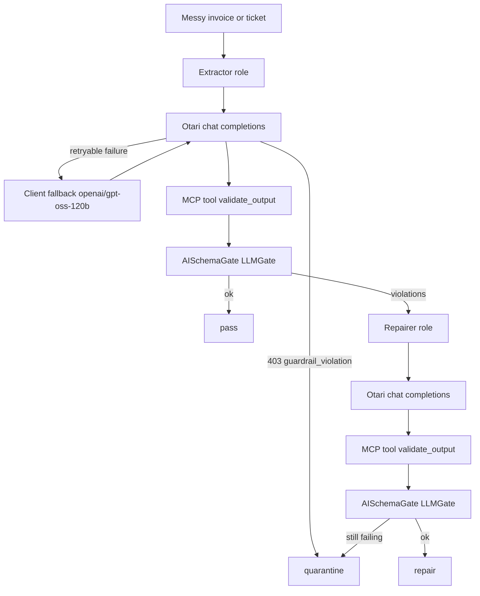

# Developers Wilding

Messy invoices and support notes go in. A JSON object that matches a contract comes out, or the note is quarantined.

An extractor model on the hosted [Otari](https://otari.ai) gateway turns the note into JSON. [AISchemaGate](https://www.aischemagate.dev/docs/llm-sdk-reference) (`LLMGate` from `aischemagate`) checks types, enums, and ranges. When the check fails, a repairer model from a different vendor rewrites the JSON and the check runs again. Each note is reported as **pass**, **repair**, or **quarantine**.

Live calls use the workspace key in `OTARI_API_KEY`. That value is read at runtime and is never written by this repo. `--dry-run` replays authored fixtures and does not call Otari, so tests run without the key.

A hosted run already confirmed: chat completions, the extractor and repairer roles, a repair (Qwen, then Mistral), that the `guardrails` field is accepted, and that `user` is sent only when set because a mismatched `user` is rejected. Still unverified on a completion: hosted MCP, the workspace and member spend caps, and the `Otari-End-User-Budget` header. A second hosted run on 2026-10-30 also confirmed a live fallback (`example/not-a-deployed-model` returned HTTP 400 `invalid_model`, then `openai/gpt-oss-120b` answered) and a live quarantine (sample 04 stayed missing `ticket_id` after the repairer). In that earlier run sample 05 (guardrail mode `block`, profile `prompt-injection`) got HTTP 502 from both Qwen and gpt-oss and ended as an error, because no guardrail service was configured yet. A later run on 2026-10-30 at 12:25 PM ET, with profile `wilding-prompt-injection`, did block: sample 05 returned HTTP 403 `guardrail_violation` and the report says `blocked by guardrail`. Monitor calls on that run carried header `otari-guardrails` with `valid: true` and `score: 0.0`. Sample 04 passed on the first extraction in the policy run, so that quarantine is model-dependent. Live finding (2026-10-30, three probes): with guardrail mode `block`, the gateway answered HTTP 502 with detail "guardrail profile 'prompt-injection' requested but no guardrails service is configured. Set OTARI_GUARDRAILS_URL on the gateway or pass `url` on the guardrail entry." That happened on sample 05 and on a plain hello prompt. With mode `monitor`, sample 05 returned HTTP 200 and header `Otari-Guardrails` `[{"profile":"prompt-injection","mode":"monitor","valid":null,"score":null}]`, which means the check was not evaluated. The client now reports a 5xx whose detail mentions a guardrail, when guardrails are sent, as status `error` with code `guardrail_upstream_error`. It is not retried on the fallback model, and it is never counted as a block, flag, or quarantine. Open upstream question (owner: Alex Suarez): how a hosted workspace enables the guardrails service, or which `url` a guardrail entry should name. Sample 02 passed on the first extraction in that run, so it was not repaired. The 12:25 PM ET run verified those two policy names and guardrail `wilding-prompt-injection`. Still dashboard-configured, not live-verified: budget `wilding-cap` at $2 monthly as workspace ceiling `wilding-workspace-ceiling`, and member budget `wilding-member-cap` at $1. `--direct-models` keeps the vendor/model ids and the client-side gpt-oss fallback.

An unauthenticated probe on 2026-10-30 checked the URL shape only: `GET https://otari.ai/api/v1/models` returned HTTP 401, and `GET https://api.otari.ai/v1/models` returned HTTP 404 telling the client to use `/api/v1`.

## Architecture



Roles:

| Role | What a live run sends | Direct-model option |
| --- | --- | --- |
| Extractor | `wilding-extractor` | `alibaba/qwen3-235b-a22b-instruct-2507`, then `openai/gpt-oss-120b` |
| Repairer | `wilding-repairer` | `mistralai/mistral-small-3.2-24b-instruct-2506`, then `openai/gpt-oss-120b` |

A live run sends the routing policy name as `model` (`--use-policies`, the live default). `--direct-models` sends the plain `vendor/model` ids and, if that call fails in a retryable way, `openai/gpt-oss-120b`. Sample `03_invoice_fallback` always uses that direct list, including under `--use-policies`, so the client fallback stays visible. Role calls set `max_tokens` (default 256, clamped at 512), `temperature` 0, and `response_format` `json_object`. The client-side gpt-oss call uses `max_tokens` 2048. 2048 is a bound so the cap is not spent before the JSON; it is not a measured minimum. A policy request uses the role cap, because the gateway applies that cap to whichever entry it picks. `user` is omitted unless `--user` or `OTARI_USER` is set.

Validation is `LLMGate.validate_only`, reached through the MCP tool `validate_output`. The gate is constructed with the caller's OpenAI-compatible client (`llm=`). The check runs in-process on the engine installed with `aischemagate`. The hosted AISchemaGate egress API was not called.

## Quickstart

```bash
python -m pip install -e ".[dev]"
python -m demo run samples/ --dry-run
pytest -q
```

Live run, after the dashboard steps below:

```bash
export OTARI_API_KEY="paste-the-workspace-key-here"
python -m demo run samples/
```

That live command uses `--use-policies`: the request `model` is `wilding-extractor` or `wilding-repairer`. A hosted run on 2026-10-30 at 12:25 PM ET got HTTP 200 from both (`wilding-extractor` on DeepInfra Qwen3, `wilding-repairer` on OVHcloud Mistral). Pass `--direct-models` to send the vendor/model ids and the client-side gpt-oss fallback instead. Do not pass `--user` unless that string is the API key's own user. A hosted run rejected a mismatched `user`. Do not commit the key. `.env.example` lists the variable names with empty values.

Other entry points:

```bash
python -m demo run samples/ --dry-run --json
python -m demo mcp
```

`python -m demo mcp` speaks newline-delimited JSON-RPC on stdio and exposes `validate_output`.

## Otari features used

Judges should score a feature only where this repo actually exercises it. "Live-verified" means a hosted call already observed it. A dry-run does not add to that list.

| Feature | What the code does | Where | Live-verified |
| --- | --- | --- | --- |
| Distinct model roles | Extractor and repairer are different open-weight ids from different vendors. Each sample names one role, then the other only after a contract violation. | `demo/config.py`, `demo/pipeline.py` (`extractor_models`, `repairer_models`) | Yes. A hosted run repaired with Qwen, then Mistral. |
| Routing / fallback | Live default `--use-policies` sends `wilding-extractor` or `wilding-repairer` and does not add a client-side second model. `--direct-models` sends the vendor/model id, then `openai/gpt-oss-120b` at `max_tokens` 2048. Retryable statuses include 404, 408, 409, 429, 500, 502, 503, 504, transport errors, and a 400/422 whose body says the model does not exist. A guardrail result and a budget refusal are not retried. Sample `03_invoice_fallback` keeps the direct list (`example/not-a-deployed-model`, then gpt-oss) even in policy mode. | `demo/cli.py`, `demo/pipeline.py`, `samples/03_invoice_fallback/options.json` | Live-verified on 2026-10-30 12:25 PM ET: both policy names returned HTTP 200 (DeepInfra Qwen3, OVHcloud Mistral). Client-side fallback was already live-verified (HTTP 400 `invalid_model`, then gpt-oss). |
| Budget cap | Inputs are a few lines. Role `max_tokens` defaults to 256 and is clamped to 512. The client-side reasoning fallback uses 2048. A body whose code or detail contains `budget` on HTTP 402, 403, or 429 raises `BudgetExceeded` and the run stops. | `demo/config.py`, `demo/otari.py`, `demo/cli.py` | The $2 workspace ceiling and the $1 member budget are dashboard-configured, not observed on a completion. |
| Per-user attribution | `user` is omitted unless `--user` or `OTARI_USER` is set. When `OTARI_END_USER_BUDGET` is set, the client also sends header `Otari-End-User-Budget`. | `demo/otari.py` `_payload` | The omit-unless-set behavior and the rejection of a mismatched `user` are live-verified. The budget header is not. |
| Guardrails | Requests send `guardrails: [{profile, mode, on: [input]}]` unless `--guardrail-mode off`. Default profile `wilding-prompt-injection`, mode `monitor`. Sample `05_ticket_guardrail` sets mode `block`. HTTP 403 whose `code` is `guardrail_violation` (top-level or under `error`) is reported as `blocked by guardrail`, not a generic error. Monitor responses keep the `otari-guardrails` header verdicts on the report line. A 5xx whose detail mentions a guardrail is `guardrail_upstream_error`. | `demo/otari.py`, `demo/report.py`, `samples/05_ticket_guardrail/options.json` | Live-verified 2026-10-30 12:25 PM ET. Monitor header example: `[{"profile":"wilding-prompt-injection","mode":"monitor","valid":true,"score":0.0}]`. Sample 05 block: HTTP 403 `{"message":"Request blocked by guardrail policy.","code":"guardrail_violation","guardrails":[{"profile":"wilding-prompt-injection","explanation":null,"score":1.0}]}`. |
| MCP | Tool `validate_output` is the validation path the pipeline calls, via the same JSON-RPC handler as `python -m demo mcp`. Stdio is newline-delimited JSON. `Content-Length` is still accepted. `initialize` echoes the client's `protocolVersion` when it is supported, otherwise `2025-06-18`. Hosted Otari needs a Streamable HTTP URL. This stdio server is not that URL. | `demo/mcp_server.py`, `demo/pipeline.py` | No |

## Dashboard

Policies `wilding-extractor` and `wilding-repairer`, and guardrail `wilding-prompt-injection` (monitor and block), were live-verified on 2026-10-30 at 12:25 PM ET. The spend caps below are dashboard-configured and were not shown stopping a call. Hosted MCP is still an operator step.

### API key

1. Open the workspace (top-left).
2. Open **API Keys**.
3. Click **Create Key**. Copy the token once. It is shown only then.
4. Export it as `OTARI_API_KEY` in the shell. Do not put it in the repo.

The published quickstart still shows `https://api.otari.ai/v1`. The live host probe above answered that path with HTTP 404 and said to use `/api/v1`. This client posts to `https://otari.ai/api/v1/chat/completions`. Override with `--base-url` or `OTARI_BASE_URL` if your workspace documents a different origin.

Confirm a call, when you make one, on the workspace **Usage** tab. This repo has not seen that tab.

### Routing policies (live-verified 2026-10-30 12:25 PM ET)

A hosted run sent these names as `model` and got HTTP 200. `wilding-extractor` was served by DeepInfra Qwen3. `wilding-repairer` was served by OVHcloud Mistral.

| Policy name sent as `model` | Chain |
| --- | --- |
| `wilding-extractor` | Qwen3-235B-A22B-Instruct-2507 on DeepInfra, then gpt-oss-120b |
| `wilding-repairer` | Mistral-Small-3.2-24B on OVHcloud, then gpt-oss-120b |

`--use-policies` (default when the run is not `--dry-run`) sends those names and does not add a second client-side model. `--direct-models` sends `alibaba/qwen3-235b-a22b-instruct-2507` or `mistralai/mistral-small-3.2-24b-instruct-2506`, then `openai/gpt-oss-120b` if the first call is retryable. That client-side path is the one a hosted run already showed (HTTP 400 `invalid_model` on a missing id, then gpt-oss).

### Budgets (dashboard-configured, not live-verified)

No completion has been shown hitting either cap.

| Name | Setting |
| --- | --- |
| `wilding-cap` | $2, monthly |
| `wilding-workspace-ceiling` | Workspace ceiling that applies `wilding-cap` |
| `wilding-member-cap` | Member budget, $1 |

Per-user attribution on the request:

- A hosted run rejected a `user` that did not match the API key. This client therefore omits `user` unless `--user` or `OTARI_USER` is set to that key's own user. That behavior is live-verified.
- The self-hosted access-control page (`docs.otari.ai/otari/for-operators/access-control.md`) documents service keys: the first request that carries a new `user` creates an end user, and header `Otari-End-User-Budget` selects the budget at creation time. Later requests keep the budget already stored. That page is the operator guide, not the hosted Spend & Budgets wizard. Set `OTARI_END_USER_BUDGET` only after the key is a service key that is allowed to assign that budget. The header's effect on hosted otari.ai is **unverified**.

Exact error code for an exhausted ceiling was not in the pages read. The client treats HTTP 402, 403, or 429 as a budget stop when the code or detail contains `budget`, and it does not try the fallback model.

### Guardrail (live-verified 2026-10-30 12:25 PM ET)

Profile `wilding-prompt-injection` ran. Monitor responses carried header `otari-guardrails`, for example:

```json
[{"profile":"wilding-prompt-injection","mode":"monitor","valid":true,"score":0.0}]
```

Sample 05 (`block`) returned HTTP 403:

```json
{"message":"Request blocked by guardrail policy.","code":"guardrail_violation","guardrails":[{"profile":"wilding-prompt-injection","explanation":null,"score":1.0}]}
```

The client reports that as `blocked by guardrail` and does not call the repairer. `code` is read from the top level or from `error`. The report also prints `otari-guardrails` header verdicts on the sample line. An earlier run that sent profile `prompt-injection` before this guardrail existed got HTTP 502 and is still reported as `guardrail_upstream_error`, not as a block.

### MCP

From [Add an MCP server](https://docs.otari.ai/tools/add-an-mcp-server):

1. Select the workspace.
2. Open **Tools → MCP servers**.
3. Click **Add MCP server**.
4. Name: `aischemagate-validate`.
5. URL: an HTTPS endpoint Otari's gateway can reach. The stdio command `python -m demo mcp` is not a URL and cannot be entered here.
6. Allowed tools: `validate_output`.
7. Leave **Enabled** on.
8. Click **Add MCP server**.

Copy the saved server id into `OTARI_MCP_SERVER_ID` if you want requests to include `mcp_server_ids`. Put a public HTTPS URL in `OTARI_MCP_URL` if you want inline `mcp_servers`. Neither variable is set by default, and neither path was live-verified.

What does run: the pipeline calls `validate_output` through the local MCP handler, and `python -m demo mcp` serves that tool on stdio. Tests drive the stdio process.

## Samples and fixtures

| Sample | Contract | Dry-run classification |
| --- | --- | --- |
| `01_invoice_pass` | `invoice_v1` | pass |
| `02_invoice_repair` | `invoice_v1` | repair (currency, total, status) |
| `03_invoice_fallback` | `invoice_v1` | Names `example/not-a-deployed-model`, then `openai/gpt-oss-120b`. Dry-run replays HTTP 404 then a valid invoice. Live: HTTP 400 `invalid_model`, then gpt-oss-120b answered (pass). |
| `04_ticket_quarantine` | `ticket_v1` | The note has no ticket number, and the prompts forbid inventing `ticket_id`. The dry-run fixture omits the field, so it quarantines. That outcome is model-dependent: the 2026-10-30 12:25 PM ET policy run passed on the first extraction. |
| `05_ticket_guardrail` | `ticket_v1` | Prompt-injection text, guardrail mode `block`. Dry-run replays HTTP 403 and reports `blocked by guardrail`. Live on 2026-10-30 12:25 PM ET: HTTP 403 `guardrail_violation`, score 1.0. |

Fixtures under `fixtures/` are authored stand-ins for the gateway JSON shape. They are not captures of live model output. Counts printed by the CLI are how this run classified those inputs. They are not a quality or latency measurement.

Contracts live in `demo/contracts/` and declare enums and numeric ranges. Compliance mode rejects fields the contract does not list.

## License

MIT. See `LICENSE`.

Direct dependencies are `aischemagate` (MIT) and, for tests, `pytest` (MIT). `aischemagate` installs `certifi` (MPL-2.0) and `typing_extensions` (PSF-2.0). Those two are kept only because the required package pulls them in. This repo does not import them. `tests/test_licenses.py` fails the build if a newly added distribution is outside MIT, ISC, BSD, 0BSD, or that pair of exceptions. Dual-licensed distributions are accepted when one side is MIT, ISC, BSD, or 0BSD.

## More

- Rubric map: `docs/HACKATHON.md`
- Two-to-three minute demo outline: `docs/DEMO_SCRIPT.md`
